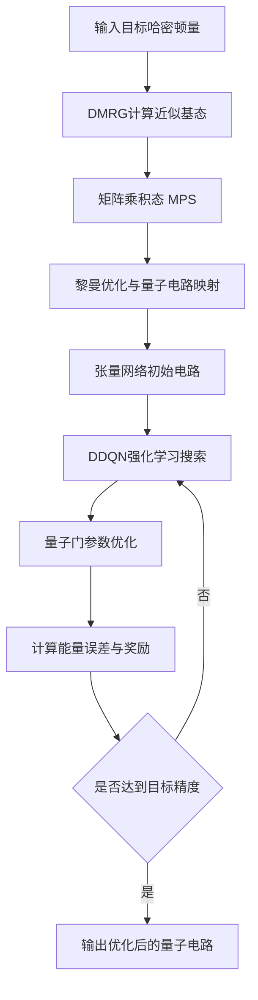

# TensorRL-QAS: Reinforcement Learning with Tensor Networks for Improved Quantum Architecture Search

## 1. 论文基本信息

| 项目 | 内容 |
| --- | --- |
| 作者 | Akash Kundu, Stefano Mangini |
| 发表年份 | 2025 |
| 发表会议 | NeurIPS 2025 |
| CCF等级 | A类 |
| 研究方向 | 量子架构搜索、量子电路优化 |
| 主要方法 | 张量网络、DMRG、MPS、DDQN |
| 论文链接 | [Paper](https://arxiv.org/abs/2505.09371) |
| 源代码 | [GitHub](https://github.com/Aqasch/TensorRL-QAS) |
| 复现状态 | 待复现 |

| 硬件 | 本论文实验配置 |
| --- | --- |
| CPU | MD EPYC Rome 7H12 |
| CPU 架构 | AMD Zen 2 |
| CPU 资源分配 | 2 CPUs |
| GPU | NVIDIA A100 |
| GPU 架构 | Ampere |
| GPU 显存上限 | 40 GB |
| CPU 内存分配 | 每 CPU 最大 4 GB |
| 量子模拟器 | Qulacs |
## 2. 研究背景与问题

量子架构搜索（Quantum Architecture Search，QAS）旨在自动设计适合特定计算任务的量子电路，包括量子门类型、作用位置、连接方式和电路深度。

传统基于强化学习的量子架构搜索方法通常从空电路开始搜索，随着量子比特数量增加，存在以下问题：

- 搜索空间迅速扩大，训练难度增加。
- 每次改变电路结构后，需要重新优化量子门参数，计算成本较高。
- 大规模量子系统中，强化学习的收敛速度和成功率较低。
- 量子门数量和电路深度增加，容易受到硬件噪声影响。

本文提出 TensorRL-QAS，将传统张量网络方法与强化学习结合，利用具有物理意义的初始量子电路缩小搜索范围，提高搜索效率。

## 3. 研究目标

针对给定的哈密顿量，自动搜索能够近似制备目标基态的参数化量子电路。

主要优化目标：

- 降低基态能量计算误差。
- 减少双量子比特门（CNOT）数量。
- 降低量子电路深度。
- 减少强化学习训练时间。
- 提高架构搜索成功率。

## 4. 核心方法

### 4.1 整体技术路线

### 4.2 张量网络初始化

利用密度矩阵重整化群（DMRG）计算目标量子系统的近似基态，并使用矩阵乘积态（MPS）表示。

MPS通过多个相互连接的小张量表示量子状态，避免直接存储完整的指数规模状态向量。

论文主要采用键维度（Bond Dimension）χ=2，在计算成本与状态表达能力之间取得平衡。

### 4.3 MPS到量子电路的转换

利用黎曼优化将MPS映射为砖墙式（Brickwork）参数化量子电路，并进一步分解为基础量子门：

- RX
- RY
- RZ
- CNOT

生成的初始电路已经能够近似表示目标基态，为强化学习提供较好的搜索起点。

该过程称为热启动（Warm-start）。

### 4.4 强化学习架构搜索

采用双深度Q网络（DDQN）进行量子电路结构搜索。

| 强化学习要素 | 对应内容 |
| --- | --- |
| State | 当前量子电路的编码表示 |
| Action | 选择并添加量子门 |
| Reward | 根据能量误差和任务完成情况提供反馈 |
| Agent | 决定下一步添加的量子门及其位置 |
| Environment | 量子电路模拟、参数优化和能量计算 |
| Episode | 一次完整的量子电路搜索过程 |

强化学习负责搜索量子电路结构，经典优化器负责优化量子门的连续参数。

这也就是为什么传统RL-QAS计算成本很高的原因：每搜索一种新结构，都需要反复进行参数优化。

### 4.5 不同初始化策略

| 方法 | 初始电路 | 初始参数 | 优化方式 |
| --- | --- | --- | --- |
| Vanilla RL | 无 | 无 | 从头搜索 |
| StructureRL | 张量网络电路 | 参数置零 | 优化初始参数和新增电路 |
| TensorRL Trainable | 张量网络电路 | DMRG初始化 | 优化初始参数和新增电路 |
| TensorRL Fixed | 张量网络电路 | DMRG初始化 | 冻结初始部分，仅优化新增电路 |
| TN-VQE | 张量网络电路 | DMRG初始化 | 使用固定后续结构进行参数优化 |

通过不同初始化策略，分析初始电路结构、初始参数和强化学习搜索对最终性能的影响。

## 5. 实验设计与结果

### 5.1 实验对象

| 计算任务 | 量子比特数量 |
| --- | --- |
| BeH₂分子基态计算 | 6 |
| H₂O分子基态计算 | 8、10 |
| LiH分子基态计算 | 12 |
| CH₂O分子基态计算 | 8、10 |
| Heisenberg模型 | 5 |
| 横场伊辛模型（TFIM） | 6、15、17、20 |

主要评价指标：

- Energy Error：计算能量与参考基态能量的误差。
- Circuit Depth：量子电路深度。
- CNOT Count：双量子比特门数量。
- Rotation Gate Count：旋转门数量。
- Success Rate：达到目标精度的比例。
- Function Evaluations：经典优化器的目标函数评估次数。
- Episode Time：单个强化学习回合的运行时间。

分子基态计算采用化学精度作为成功标准，即能量误差不超过0.0016 Hartree。

### 5.2 实验一：无噪声环境下的架构搜索

在理想量子模拟环境中，比较TensorRL与传统量子架构搜索方法。

以8量子比特H₂O为例：

| 方法 | 能量误差 | 电路深度 | CNOT数量 | 旋转门数量 |
| --- | ---: | ---: | ---: | ---: |
| Vanilla RL | 0.00017 | 96 | 117 | 48 |
| CRLQAS (rerun) | 0.00017 | 100 | 85 | 58 |
| quantumDARTS | 0.00031 | 64 | 68 | 151 |
| StructureRL | 0.00013 | 33 | 30 | 133 |
| TensorRL Trainable | 0.00020 | 36 | 30 | 146 |
| TensorRL Fixed* | 0.00089 | 6 | 9 | 15 |

实验结论：

- TensorRL能够在满足化学精度的情况下减少CNOT数量和电路深度。
- Trainable版本相比CRLQAS，CNOT数量减少约65%。
- 旋转门数量并未同步减少，说明方法主要改善双量子比特门成本。
- Fixed版本计算效率较高，但最终能量误差不一定最低。

**注意：Fixed版本的电路资源统计仅包含强化学习新增部分，不包含张量网络初始电路。**

不同分子任务下的TensorRL Fixed结果：

| 计算任务 | 能量误差 | 是否达到化学精度 |
| --- | ---: | --- |
| 6-qubit BeH₂ | 0.000068 | 是 |
| 8-qubit H₂O | 0.00089 | 是 |
| 10-qubit H₂O | 0.00041 | 是 |
| 12-qubit LiH | 0.024 | 否 |

12量子比特LiH任务中，Trainable版本的能量误差为0.01，同样未达到化学精度，说明复杂系统中的搜索能力仍然有限。

数据来源：论文Table 1。

### 5.3 实验二：训练效率

以8量子比特H₂O为例，比较不同方法的计算成本。

| 方法 | 相比CRLQAS的单回合耗时降幅 |
| --- | ---: |
| TensorRL Trainable | 80% |
| TensorRL Fixed | 98% |

TensorRL将经典优化器的目标函数评估次数减少约10至100倍。

主要原因：

- 初始电路已经接近目标状态，减少无效搜索。
- Fixed版本不需要重复优化初始电路参数。
- 强化学习需要搜索的新增量子门数量较少。

注意：98%的耗时降幅仅针对单个强化学习回合，并不代表包含DMRG计算和电路映射在内的完整流程耗时减少98%。

数据来源：论文Figure 3。

### 5.4 实验三：架构搜索成功率

在10量子比特任务中，TensorRL Fixed的搜索成功率最高达到50%，而多数传统基线方法不足1%。

实验表明，张量网络初始化能够提高强化学习找到有效电路的概率。

但50%为最佳初始化条件下的结果，并非所有实验的平均成功率。不同随机初始化之间仍存在性能差异。

数据来源：论文Appendix H.3。

### 5.5 实验四：有噪声环境下的架构搜索

实验对象为8量子比特H₂O。

噪声设置：

| 噪声类型 | 实验参数 |
| --- | --- |
| 单量子比特门退极化噪声 | 1% |
| 双量子比特门退极化噪声 | 5% |
| 采样噪声（Shot Noise） | 10,000 shots |

退极化噪声实验结果：

| 方法 | 能量误差 | 电路深度 | CNOT数量 | 成功率 |
| --- | ---: | ---: | ---: | ---: |
| TensorRL Fixed* | 0.00090 | 7 | 5 | 100% |
| TensorRL Trainable | 0.00248 | 33 | 22 | 0% |
| StructureRL | 0.00260 | 28 | 22 | 0% |
| CRLQAS | 0.00130 | 22 | 11 | 30% |

实验结论：

- Fixed版本在该噪声条件下表现出较好的鲁棒性。
- 冻结初始电路能够减少噪声对参数优化过程的干扰。
- Trainable版本虽然具有更多可训练参数，但在该实验中未达到目标精度。
- Fixed版本的门数量不包含初始电路，完整硬件执行成本需要进一步评估。

论文还进行了采样噪声实验及IBM Brisbane硬件噪声相关评估，但未在真实量子计算机上完成强化学习训练。

数据来源：论文Table 2及Appendix G。

### 5.6 实验五：大规模量子系统的可扩展性

使用横场伊辛模型（TFIM）验证方法在15至20量子比特系统中的表现。

磁场强度设置为h=0.001。

| 量子比特数量 | 最终能量误差 | 相比初始MPS的改善幅度 |
| --- | ---: | ---: |
| 15 | 0.00044 | 21% |
| 17 | 0.00048 | 19% |
| 20 | 0.00067 | 1% |
| 20（扩展动作空间） | 0.00061 | 9% |

随着量子比特数量增加，原始动作空间的优化能力下降。

作者进一步加入XX、YY、ZZ双量子比特操作，使20量子比特任务的改善幅度从1%提高至9%。

实验说明：

- TensorRL能够扩展至特定的20量子比特物理模型。
- 原始动作空间和MPS键维度限制了大规模系统的优化能力。
- 增加具有物理意义的候选量子门能够改善搜索效果。

该实验不能证明方法能够有效解决任意20量子比特的量子化学问题。

数据来源：论文Appendix H.6、Table 7。

### 5.7 实验六：初始化策略与消融实验

通过Vanilla RL、StructureRL、TensorRL和TN-VQE进行对照，分析不同组件的贡献。

8量子比特H₂O实验结果：

| 方法 | 能量误差 | 电路深度 | CNOT数量 |
| --- | ---: | ---: | ---: |
| Vanilla RL | 0.00017 | 96 | 117 |
| StructureRL | 0.00013 | 33 | 30 |
| TensorRL Trainable | 0.00020 | 36 | 30 |
| TN-VQE | 0.00270 | 10 | 14 |

StructureRL与TensorRL Trainable的最终性能接近，说明张量网络提供的初始电路结构本身具有重要价值。

TN-VQE未达到化学精度，说明在该实验设置下，仅依靠张量网络初始化和固定结构参数优化仍然存在不足。

作者还比较了不同初始电路层数：

| 初始电路层数 | 8-qubit H₂O成功率 | 10-qubit H₂O成功率 |
| --- | ---: | ---: |
| 1 | 14% | 13% |
| 2 | 14% | 11% |
| 3 | 0% | 0% |

实验说明初始电路并非越复杂越好，需要在表达能力和强化学习的搜索难度之间取得平衡。

数据来源：论文Table 1、Appendix I、Table 8。

## 6. 主要创新点

### 6.1 张量网络与强化学习结合

利用DMRG获得近似基态，为强化学习提供具有物理意义的初始电路，避免从空电路开始搜索。

### 6.2 固定与可训练初始化策略

通过冻结或调整初始电路参数，平衡搜索灵活性与计算成本，提高架构搜索效率。

### 6.3 量子电路结构与参数联合优化

利用强化学习搜索量子门类型及其位置，利用经典优化器调整连续参数，实现电路结构和参数的协同优化。

### 6.4 面向大规模量子系统的搜索

通过张量网络初始化减少强化学习的搜索负担，并验证方法在不同分子及多体物理模型中的适用性。

## 7. 局限性

### 7.1. 作者明确提出的局限性

1. 初始化策略有限： 仅研究了初始电路参数完全可训练（Trainable TN-init）和完全固定（Fixed TN-init）两种策略，尚未探索其他中间方案，例如允许智能体获取初始电路信息，但不修改其参数。

2. 动作空间有限： 原始强化学习动作空间仅包含 RX、RY、RZ 和 CNOT 门。随着量子比特数量和问题复杂度增加，有限的量子门类型可能难以满足复杂量子状态的制备需求。

3. 初始电路结构单一： 仅采用 Brickwork（砖墙式）电路结构进行初始化，尚未充分研究其他参数化量子电路结构及张量网络布局。

4. 缺少真实量子硬件训练： 强化学习训练主要在经典模拟器中完成，噪声实验采用模拟噪声，并人为放大噪声强度以验证鲁棒性。尚未在真实 QPU 上完成强化学习训练，也未充分验证算法对实际设备噪声的适应能力。

### 7.2. 根据实验结果分析得到的局限性

1. 大规模复杂问题的求解能力仍然有限： 在 12 量子比特 LiH 实验中，TensorRL 的最低能量误差为 0.01 Ha，未达到 0.0016 Ha 的化学精度要求。在 20 量子比特 TFIM 实验中，原始方法相比初始 MPS 仅改善了 1%，扩展动作空间后提升至 9%。说明算法虽然能够处理更大规模的系统，但优化能力仍存在瓶颈。（Table 1、Table 7）

2. 对初始化质量和结构较为敏感： 增加初始电路层数并不一定能够改善搜索效果。在 8 和 10 量子比特 H₂O 实验中，当初始电路增加至三层时，搜索成功率均下降至 0%。因此，如何根据具体问题选择合适的键维度、初始电路结构和深度，仍需要进一步研究。（Table 8）

3. 张量网络初始参数的贡献存在一定局限： 在部分无噪声实验中，初始参数置零的 StructureRL 能够达到甚至超过 TensorRL Trainable 的最终精度。这说明性能提升不仅来自 DMRG 提供的初始参数，也与初始电路结构有关，需要进一步区分两者对搜索效率和最终性能的贡献。（Table 1）

4. 完整电路资源对比存在统计口径差异： TensorRL Fixed 报告的部分 CNOT 数量和电路深度仅包含强化学习新增的量子门，未计入初始电路的资源开销。因此，实际部署时需要统计完整电路的资源消耗，才能与其他方法进行公平比较。（Section 4.1、Appendix M.4）

5. 整体计算效率仍需进一步验证： 论文报告的最高 98% 耗时降幅针对单个强化学习回合，而非完整算法流程。实际计算成本还应包括 DMRG 求解、MPS 到量子电路的映射以及强化学习训练时间。（Section 4.1）

6. 跨任务和跨规模泛化能力尚未得到充分验证： 虽然论文在不同分子和物理模型上进行了实验，但尚未证明已经训练好的智能体能够直接迁移至其他分子、哈密顿量或不同数量的量子比特，而无需重新训练。

## 8. 后续研究方向

以下为个人研究思考，并非原论文已经完成的工作。

| 研究方向 | 研究内容 |
| --- | --- |
| 自适应张量网络初始化 | 根据任务复杂程度自动选择MPS键维度和初始电路层数 |
| 动态动作空间 | 根据哈密顿量和当前电路状态筛选候选量子门 |
| 噪声感知架构搜索 | 将非均匀噪声、空间热点噪声和时变噪声纳入强化学习决策 |
| 部分参数冻结 | 根据初始电路中不同参数的重要程度选择性冻结或更新 |
| 跨规模迁移学习 | 将小规模量子系统中学习的策略迁移至更大规模系统 |
| 多目标优化 | 同时考虑能量误差、门数量、电路深度、噪声成本和运行时间 |
| 量子机器学习架构搜索 | 将该方法扩展至QNN、VQC等量子机器学习任务 |

其中，自适应初始化、动态动作空间和噪声感知架构搜索具有较明确的实验切入点。

具体创新性仍需结合相关研究进一步确认。

## 9. 复现计划

### 9.1 实验环境

- Python 3.10
- Conda
- PyTorch
- Quimb
- Qiskit
- VS Code
- CPU / GPU

具体依赖版本以原始仓库requirements.txt为准。

### 9.2 复现步骤

- [ ] 下载源代码并配置实验环境。
- [ ] 运行DMRG，生成目标系统的MPS。
- [ ] 完成MPS到参数化量子电路的转换。
- [ ] 复现6量子比特BeH₂无噪声实验。
- [ ] 复现8量子比特H₂O无噪声实验。
- [ ] 对比Fixed、Trainable和StructureRL。
- [ ] 统计能量误差、完整电路深度、CNOT数量及运行时间。
- [ ] 复现退极化噪声和采样噪声实验。
- [ ] 尝试改进初始化策略或动作空间。

优先开展小规模CPU实验，验证方法的正确性和可行性，再考虑更大规模的训练。

## 10. 相关术语

| 专有名词 | 解释 |
| --- | --- |
| QAS | 量子架构搜索，自动寻找适合特定任务的量子电路结构 |
| VQE | 变分量子本征求解器，用于近似求解量子系统的基态能量 |
| Tensor Network | 张量网络，通过多个相互连接的张量表示复杂量子状态 |
| MPS | 矩阵乘积态，一种链式张量网络表示方法 |
| DMRG | 密度矩阵重整化群，用于近似计算量子多体系统基态的经典数值方法 |
| Bond Dimension | 键维度，决定张量网络的表达能力和计算成本 |
| Warm-start | 热启动，利用已有近似解作为优化算法的初始状态 |
| DDQN | 双深度Q网络，通过分离动作选择和价值评估缓解Q值过估计问题 |
| Hamiltonian | 哈密顿量，描述量子系统能量及相互作用的算符 |
| Chemical Accuracy | 化学精度，本文采用约0.0016 Hartree的能量误差标准 |
| TFIM | 横场伊辛模型，用于研究量子多体系统相互作用的物理模型 |
| Brickwork Circuit | 砖墙式量子电路，相邻量子比特之间交错排列双比特操作的电路结构 |

## 11. 个人总结

本文的核心思想是利用传统张量网络方法获得具有物理意义的近似解，再通过强化学习进一步优化量子电路，避免AI从零开始搜索。

实验表明，该方法能够降低强化学习的计算成本，并在部分任务中减少量子电路深度和双量子比特门数量。但其性能仍然受到初始状态质量、动作空间和量子系统规模的限制。

值得借鉴的是传统算法与AI的融合方式。传统算法负责提供可靠的初始解，AI负责进一步优化传统方法难以解决的问题。

这一思想也可以应用于AI量子纠错，例如保留传统MWPM解码器，利用AI进行噪声估计和匹配权重优化。

## 12. References

- [NeurIPS 2025 Proceedings](https://proceedings.nips.cc/paper_files/paper/2025/hash/af008ae1c0301e218ee89a86833198e3-Abstract-Conference.html)
- [Original Paper](https://openreview.net/pdf?id=0okFLZvtKs)
- [arXiv](https://arxiv.org/abs/2505.09371)
- [Official GitHub Repository](https://github.com/Aqasch/TensorRL-QAS)
