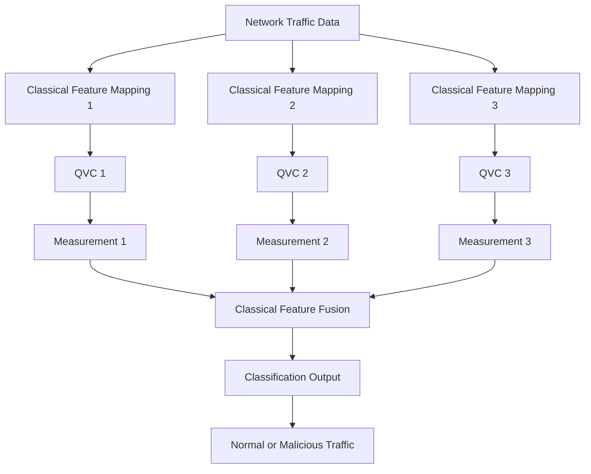

# A Case Study for Cyber-Attack Detection Using Quantum Variational Circuits

## 1. Paper Information（论文信息）

- **Journal:** Quantum Machine Intelligence
- **Year:** 2025
- **Paper:** [Original Paper](https://doi.org/10.1007/s42484-025-00277-1)
- **Code:** Available upon request
- **Research Direction:** Quantum Machine Learning, Cybersecurity, Efficient Learning
- **Keywords:** QVC, Hybrid Quantum-Classical Neural Network, Vertical Layers

## 2. Research Background（研究背景）

当前量子机器学习面临以下问题：

- 量子硬件能够支持的量子比特数量有限。
- 随着量子比特数量增加，经典模拟成本呈指数增长。
- 大规模量子电路的训练成本较高。
- 较深的量子电路可能受到更加严重的噪声影响。

本文以网络攻击检测为应用场景，研究如何使用多个小型量子变分电路（QVC）替代单个大型量子电路，在保持分类性能的同时降低单个量子处理器的资源需求。

核心问题：

> 多个小型量子电路能否共同完成一个大型量子电路所承担的学习任务？

## 3. Research Objectives（研究目标）

1. 验证量子神经网络能否达到经典神经网络的分类性能。
2. 验证多个小型量子电路能否替代单个大型量子电路。
3. 降低单个量子处理器的资源需求。
4. 验证并行量子电路在不同分类任务中的适用性。

## 4. Proposed Method（核心方法）

### 4.1 Quantum Variational Circuit（量子变分电路）

QVC 是一种包含可训练参数的量子电路。

基本流程：

1. 使用经典全连接层处理输入特征。
2. 将经典数据编码为量子门的旋转角度。
3. 执行参数化量子门和纠缠操作。
4. 测量量子态并获得经典数值。
5. 使用经典输出层完成分类。
6. 根据损失函数更新模型参数。

本文采用监督学习，而不是强化学习。

### 4.2 Horizontal Layers（横向层）

在同一个量子电路中连续增加多个参数化操作层。

主要作用：

- 增加量子电路深度。
- 提高模型表达能力。
- 学习更加复杂的特征关系。

主要问题：

- 增加电路执行成本。
- 可能增加噪声影响。
- 增加参数优化难度。

### 4.3 Vertical Layers（纵向并行层）

这是本文的核心创新。

作者使用多个独立的小型量子电路替代单个大型量子电路。

每个分支包含：

- 独立的经典特征变换层。
- 独立的参数化量子电路。
- 独立的量子测量过程。

每个分支可以从完整输入中学习不同的特征表示，最终通过经典神经网络融合所有量子分支的输出。

例如，将模型设计为三个分别包含 3、3、2 个量子比特的独立电路。

### 4.4 Model Architecture（模型架构）

### 4.5 Horizontal Layers vs. Vertical Layers

| 对比维度 | Horizontal Layers | Vertical Layers |
| --- | --- | --- |
| 基本思想 | 增加电路深度 | 增加独立电路数量 |
| 电路数量 | 单个电路 | 多个电路 |
| 独立运行 | 否 | 是 |
| 量子纠缠 | 同一电路内部 | 各分支内部 |
| 主要优势 | 提高表达能力 | 降低单个设备的资源需求 |
| 主要局限 | 电路深度增加 | 缺少跨电路量子纠缠 |

### 4.6 Computational Complexity（计算复杂度）

完整模拟一个 n 量子比特的纯量子态，需要存储 2^n 个复数振幅。

多个独立的小型量子电路则可以分别进行模拟。

| 电路结构 | 状态向量元素数量 |
| --- | ---: |
| 单个 8-qubit 电路 | 256 |
| 单个 3-qubit 电路 | 8 |
| 单个 2-qubit 电路 | 4 |
| 3+3+2 并行电路 | 20 |

多个小型量子电路可以降低经典状态向量模拟的存储需求。

但是，由于不同分支之间不存在直接的量子纠缠，因此并行电路与大型电路不具有完全相同的表达能力。

本文属于重新设计量子学习架构，而不是对已有量子电路进行等价切割（Circuit Cutting）。

## 5. Input and Output（输入与输出）

| 项目 | 内容 |
| --- | --- |
| 输入 | 经典网络流量特征 |
| 模型 | 混合量子经典神经网络 |
| 输出 | 网络流量分类结果 |
| Label 0 | 正常流量 |
| Label 1 | 恶意流量 |
| 学习方式 | 监督学习 |
| 优化器 | Adam |
| 评价指标 | Accuracy、Precision、Recall、F1-score |

本文利用量子机器学习解决经典网络安全问题，而不是检测量子计算机自身受到的攻击。

## 6. Experiments（实验设计与结果）

### 6.1 Experiment 1: Classical DNN vs. Single QVC

#### 实验目的

验证单个量子神经网络能否达到传统经典神经网络的分类性能。

#### 实验设置

| Parameter | Setting |
| --- | --- |
| Dataset | IoT-23 |
| Input Features | 11 |
| Number of Qubits | 1-11 |
| Learning Rate | 0.001, 0.01, 0.1, 0.2 |
| Epochs | 10 |
| Optimizer | Adam |
| Hyperparameter Optimization | Optuna |
| Baseline | Classical DNN |

#### 实验结果

| 指标 | 结果 |
| --- | --- |
| 经典 DNN 准确率 | 99.31% |
| 量子模型准确率差距 | 不足 0.4 个百分点 |
| 经典模型参数量 | 约为量子基线模型的 6 倍 |
| 代表性量子模型 | 9 qubits、6 horizontal layers |

#### 实验结论

量子模型没有超过经典 DNN，但能够使用较少的可训练参数获得接近经典模型的分类性能。

这说明量子模型具有一定的参数效率，但不能证明量子计算优势。

### 6.2 Experiment 2: Single QVC vs. Parallel QVC

#### 实验目的

验证多个小型量子电路能否替代单个大型量子电路。

#### 实验设置

| Parameter | Setting |
| --- | --- |
| Vertical Layers | Up to 5 |
| Qubits per Circuit | Up to 7 |
| Horizontal Layers | 2-4 |
| Learning Rate | 0.001, 0.01, 0.1, 0.2 |
| Hyperparameter Search | Optuna |
| Trials per Learning Rate | 90 |

#### 实验结果

| 指标 | 并行 QVC 相比单 QVC |
| --- | --- |
| 分类准确率 | 下降约 0.04 个百分点 |
| 整体可训练参数量 | 增加约 130 个 |
| 最大量子子模型规模 | 平均减少约 50% |

#### 实验结论

多个小型量子电路能够在基本保持分类准确率的情况下，降低单个量子子模型的规模。

需要注意：

- 减少的是最大单个量子子模型的规模。
- 整体模型的总参数量并没有减少。
- 论文没有证明训练时间减少了 50%。
- 电路可以独立运行，但不代表已经实现真实多 QPU 并行加速。

### 6.3 Experiment 3: Feature Reduction vs. Parallel QVC

#### 实验目的

比较传统特征筛选和并行量子电路在降低量子资源需求方面的效果。

#### 实验方法

使用 Spearman 相关系数分析输入特征与分类标签之间的关系。

删除绝对相关系数低于 0.01 的特征：

- duration
- obytes
- iipbytes

输入特征数量从 11 减少到 8，同时进行数据去重和多数类欠采样。

#### 实验结果

| 方法 | 准确率损失 |
| --- | --- |
| 完整特征 + Single QVC | Reference |
| 完整特征 + Parallel QVC | 约 0.04 个百分点 |
| 筛选特征 + Single QVC | 约 0.19 个百分点 |

#### 实验结论

并行 QVC 相比特征筛选具有较小的准确率损失。

但是，特征筛选实验同时改变了数据处理方式，因此不能完全隔离特征数量对分类性能的影响。

### 6.4 Experiment 4: Additional Datasets

#### 实验目的

验证并行量子电路是否能够应用于其他分类任务。

| Dataset | Task | Features | Training Samples |
| --- | --- | ---: | ---: |
| Heart Disease | 心脏疾病分类 | 10 | 192 |
| Breast Cancer | 乳腺癌分类 | 10 | 320 |
| Adult | 收入水平分类 | 12 | 1280 |

#### 实验结论

并行 QVC 可以应用于不同的分类任务，但不同数据集需要不同的量子比特数量、电路深度和并行分支数量。

论文没有证明一个训练完成的模型能够直接迁移到其他数据集。

## 7. Main Contributions（主要创新点）

1. 提出多个独立小型量子电路协同学习的架构。
2. 使用独立经典特征变换层学习不同的输入特征表示。
3. 通过经典神经网络融合不同量子电路的测量结果。
4. 在基本保持分类性能的情况下，降低单个量子处理器的资源需求。
5. 在多个分类数据集上验证并行量子学习架构的可行性。

本文的主要创新属于量子机器学习架构设计，而不是网络攻击检测算法本身。

## 8. Limitations（局限性）

### 8.1 未超过传统经典模型

经典 DNN 的分类准确率仍然高于量子模型。

论文证明了一定的参数效率，但没有证明量子计算优势。

### 8.2 缺少实际计算效率对比

论文缺少充分的端到端计算效率验证，包括：

- Training Time
- Inference Latency
- Quantum Circuit Evaluations
- Measurement Shots
- Total Computational Cost

模型规模减少不等于实际运行时间减少。

### 8.3 缺少经典多分支网络对照

论文没有充分比较结构和参数量相匹配的经典多分支神经网络。

建议增加以下对照实验：

| Baseline | Purpose |
| --- | --- |
| Classical DNN | 传统分类基线 |
| Parameter-matched MLP | 参数效率对比 |
| Parallel MLP | 多分支结构对比 |
| Single QVC | 单量子电路基线 |
| Parallel QVC | 本文方法 |

需要进一步判断性能收益来自量子电路，还是来自多分支网络结构。

### 8.4 缺少跨电路量子纠缠

不同量子电路之间不存在直接的量子纠缠。

对于需要学习复杂全局特征关联的任务，多个小型量子电路可能无法完全替代大型量子电路。

### 8.5 缺少真实噪声环境验证

缺少充分的真实量子硬件和复杂噪声环境验证，例如：

- Depolarizing Noise
- Readout Noise
- Spatially Heterogeneous Noise
- Time-varying Noise
- Crosstalk Noise

### 8.6 网络安全应用验证有限

四个实验数据集中，只有 IoT-23 属于网络安全数据集。

缺少以下应用场景的充分验证：

- 未知攻击类型检测。
- 跨网络环境泛化。
- 类别不平衡。
- 实时入侵检测。
- 对抗样本鲁棒性。

### 8.7 原始代码未公开

作者代码需要通过申请获得，未提供可以直接下载的完整公开代码仓库。

## 9. Future Research Directions（未来研究方向）

以下为基于本文提出的后续研究设想，并非原论文已经完成的工作。

### 9.1 Adaptive Multi-Circuit Quantum Architecture Search

自适应多量子电路架构搜索。

原论文使用 Optuna 进行超参数搜索，可以进一步使用强化学习或进化算法自动优化：

- 并行量子电路数量。
- 每个电路的量子比特数量。
- 量子电路深度。
- 量子门类型。
- 特征融合策略。

可以结合 TensorRL-QAS 等量子架构搜索方法开展研究。

### 9.2 Multi-Objective Efficient Quantum Learning

多目标高效量子学习。

同时考虑分类性能和量子计算资源，而不是仅优化分类准确率。

| Optimization Objective | Direction |
| --- | --- |
| Classification Accuracy | Maximize |
| F1-score | Maximize |
| Maximum Qubits per Circuit | Minimize |
| Total Quantum Gates | Minimize |
| Trainable Parameters | Minimize |
| Training Time | Minimize |
| Inference Latency | Minimize |
| Noise Sensitivity | Minimize |

可以使用 NSGA-II、强化学习或其他多目标优化算法寻找 Pareto 最优架构。

### 9.3 Noise-Aware Parallel Quantum Neural Networks

噪声感知并行量子神经网络。

考虑不同量子处理器具有不同的噪声水平，根据硬件噪声信息动态调整：

- 量子电路结构。
- 量子比特分配。
- 电路深度。
- 计算任务分配。
- 特征融合权重。

研究模型在非均匀噪声和动态噪声环境下的鲁棒性。

### 9.4 Efficient Quantum Image Processing

将并行量子电路扩展到图像处理任务。

不同量子分支可以分别学习：

- Spatial Features（空间特征）
- Texture Features（纹理特征）
- Edge Features（边缘特征）
- Spectral Features（光谱特征）

最终通过经典神经网络进行特征融合和分类。

该方法也可以进一步扩展至遥感图像分类和高光谱图像处理。

## 10. Reproducibility（代码复现）

| Resource | Availability |
| --- | --- |
| Paper | [Springer](https://doi.org/10.1007/s42484-025-00277-1) |
| Dataset | [IoT-23](https://doi.org/10.5281/zenodo.4743746) |
| Original Code | Available upon request |
| Suggested Framework | PyTorch + PennyLane |
| Alternative Framework | Qiskit Machine Learning |
| Estimated Difficulty | Medium |

建议复现步骤：

1. 下载并处理 IoT-23 数据集。
2. 实现经典 DNN 基线。
3. 实现单个 QVC 分类模型。
4. 实现多个并行 QVC 的混合量子经典模型。
5. 比较分类性能和模型参数量。
6. 增加经典多分支 MLP 对照实验。
7. 测试不同量子比特数量和电路深度。
8. 测试不同噪声环境下的模型性能。
9. 比较训练时间和推理时间。

注意：在没有作者原始代码的情况下，自行实现属于独立复现，而不是直接运行原论文代码。

## 11. Research Relevance（研究方向关联）

| Research Direction | Relevance |
| --- | --- |
| Quantum Machine Learning | High |
| Quantum Cybersecurity | High |
| Efficient Quantum Learning | High |
| Quantum Neural Networks | High |
| Quantum Multi-Objective Learning | Potential Extension |
| Quantum Architecture Search | Potential Extension |
| Quantum Image Processing | Potential Extension |
| Quantum Remote Sensing | Potential Extension |
| Quantum Error Correction | Low |

## 12. Overall Evaluation（总体评价）

本文以网络攻击检测为应用场景，提出多个小型量子电路协同学习的混合量子经典神经网络架构。

实验表明，相比单个大型量子电路，并行量子电路的分类准确率仅下降约 0.04 个百分点，而最大量子子模型的规模平均减少约 50%。

但是，该方法没有超过经典 DNN，也没有充分证明实际计算效率和真实量子硬件上的性能优势。

本文最值得借鉴的是通过多个小型量子电路降低单个量子处理器资源需求的架构设计思想。

后续可以结合量子架构搜索、多目标优化、噪声感知机制和经典多分支网络对照实验，进一步研究高效量子机器学习。

## 13. Related Resources（相关资源）

- [Original Paper](https://doi.org/10.1007/s42484-025-00277-1)
- [IoT-23 Dataset](https://doi.org/10.5281/zenodo.4743746)
- [PennyLane](https://github.com/PennyLaneAI/pennylane)
- [Qiskit Machine Learning](https://github.com/qiskit-community/qiskit-machine-learning)
- [TensorRL-QAS](https://github.com/Aqasch/TensorRL-QAS)
- [pymoo](https://github.com/anyoptimization/pymoo)

Note: The related repositories are reference resources, not the original source code of this paper.
